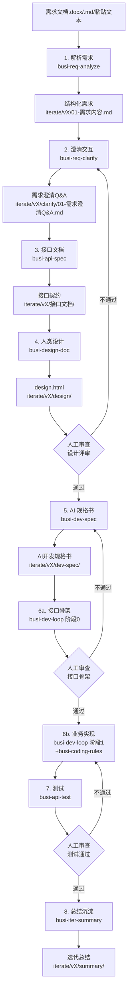

# BizFlow-8 — 8 步开发流程总览

> 本文档定义 **BizFlow-8**（`agent-base-busi-flow`，通用 AI 业务开发流程仓）的标准 SOP。每一步都对应一个或多个 Skill，并在关键节点设置人工审查卡口。

## 前置步骤：项目初始化（busi-project-init）

**不属于 8 步流程链。** 新项目首次安装 `install.ps1` 后、开始 B2 之前执行。

- 触发词：“初始化项目” / “init project”
- 职责：检测并生成 `.agent/` 下的 3 个 overlay 文件（`AGENT.md` / `coding-rules.md` / `overlay-spec.md`）
- 与安装脚本的配合：`install.ps1` 逐文件检测缺失并提醒；`-InitOverlay` 参数可非交互式脚手架生成

> overlay 未就绪时 B2-B9 各 Skill 缺少项目特化约束（包路径、分层模式、文档位置等），产出质量下降。

## 流程图

## 各阶段说明

### 1. 解析需求（busi-req-analyze）

**输入**：`.docx` / `.md` 文件、Confluence 链接、粘贴文本
**输出**：`iterate/v{版本}/01-需求内容.md` — 结构化需求（背景、目标、范围、验收标准）
**触发词**："解析需求"、"分析需求文档"、"读一下需求"

### 2. 澄清交互（busi-req-clarify）

**输入**：第 1 步产出的结构化需求
**输出**：`iterate/v{版本}/clarify/01-需求澄清Q&A.md`
**触发词**："澄清需求"、"需求拷问"、"开始澄清"
**风格**：参考 `grill-me`，逐分支拷问到共识，每问一题给推荐答案。

### 3. 接口文档（busi-api-spec）

**输入**：澄清后的需求
**输出**：
- `iterate/v{版本}/接口文档/内部/0X-{模块}.md` — 内部模块间接口
- `iterate/v{版本}/接口文档/外部/{系统名}.md` — 对外系统集成接口（请求/响应详述）

**触发词**："接口文档"、"interface spec"、"接口设计"

### 4. 人类设计文档（busi-design-doc）

**输入**：需求 + 澄清 Q&A + 接口文档
**输出**：`iterate/v{版本}/design/design.html` — HTML 形式，给前端/测试/产品评审
**内容**：业务流程图、时序图、数据模型 ER、字段中文释义、关键状态机
**触发词**："设计文档"、"design doc"、"画设计"

**DDL 来源边界**：DDL 若由人类提供（既有表 / DBA 脚本），AI 仅做合规自审，不得擅改；发现违例统一汇总到设计文档数据模型章节末尾的《表结构提示项（AI 自审，待 R1 裁决）》子节，由人工审查检查点 1 一并裁决。

**人工审查检查点 1**：设计评审通过后才能进入第 5 步。

### 5. AI 开发规格书（busi-dev-spec）

**输入**：第 4 步设计文档 + 接口文档
**输出**：
- `iterate/v{版本}/dev-spec/00-AI开发规格书.md` — 总览、模块清单、依赖顺序
- `iterate/v{版本}/dev-spec/01-{模块名}.md` — 各模块三段式（What/Where/How）
- `iterate/v{版本}/dev-spec/qa/01-{模块名}-qa.md` — 拷问 Q&A 归档

**触发词**："写规格书"、"dev spec"

> 与第 4 步关系：人类版讲"为什么这么做"（图为主），AI 版讲"具体怎么改"（路径+签名+约束）。

### 6. 编码（busi-dev-loop + busi-coding-rules）

两阶段执行：

**6a. 接口骨架阶段**
- 仅生成 Controller 方法签名 + 新增 VO/DTO/Form + 同步接口文档
- 编译验证 `mvn compile`
- **人工审查检查点 2**：接口契约 OK 才进入 6b

**6b. 业务实现阶段**
- 单功能小步快跑：编码 → 编译 → 测试 → 提交
- 编码时自动加载 `busi-coding-rules`
- 单功能完成后立即进入第 7 步测试

**触发词**："接口骨架"、"开始开发"、"start loop"

### 7. 测试（busi-api-test）

**输入**：编码完成的接口
**输出**：`<api-test-project>/src/test/java/karate/iterate/v{版本}/` 下的 `.feature` 用例
**测试方式**：Karate，最大 3 轮修复循环
**失败分类处理**：代码 Bug / 测试用例问题 / 设计缺陷（设计缺陷需回退到第 4 或第 5 步）

**人工审查检查点 3**：测试全部通过后入库。

### 8. 总结沉淀（busi-iter-summary）

**输入**：本次迭代全部交付物
**输出**：`iterate/v{版本}/summary/迭代总结.md`
**内容**：
- 需求实现回顾（哪些做了，哪些 cut 了）
- 改动文件清单（新增/修改/删除）
- 设计与实现差异（design.html 与最终代码的偏差）
- 经验沉淀（下次迭代该模块时 AI 应该知道的事）

**触发词**："迭代总结"、"沉淀"、"收官"

## 触发词速查表

| Skill | 主要触发词 |
|---|---|
| `busi-project-init` | "初始化项目"、"init project" |
| `busi-flow-orchestrator` | "启动完整流程"、"开始 8 步流程" |
| `busi-req-analyze` | "解析需求"、"分析需求文档" |
| `busi-req-clarify` | "澄清需求"、"需求拷问" |
| `busi-api-spec` | "接口文档"、"interface spec"、"接口设计" |
| `busi-design-doc` | "设计文档"、"design doc"、"画设计" |
| `busi-dev-spec` | "写规格书"、"dev spec" |
| `busi-dev-loop` | "接口骨架"、"开始开发"、"start loop" |
| `busi-coding-rules` | （编写 Java 代码时自动加载） |
| `busi-api-test` | "生成测试"、"接口测试" |
| `busi-iter-summary` | "迭代总结"、"沉淀"、"收官" |

