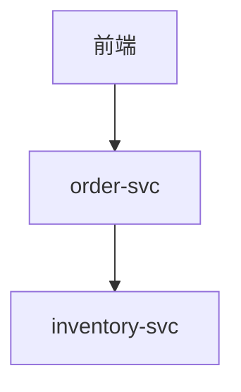
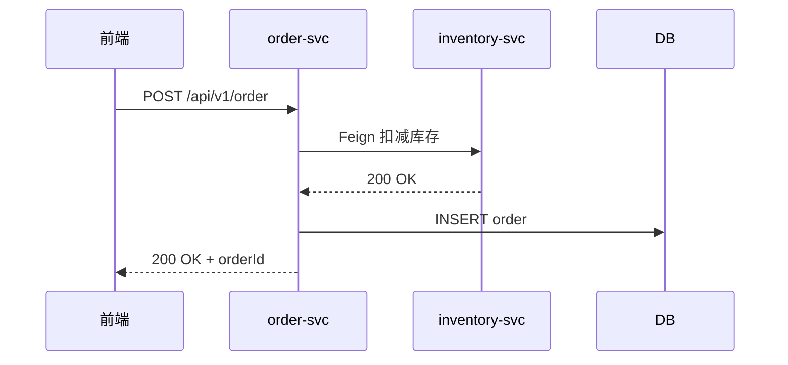
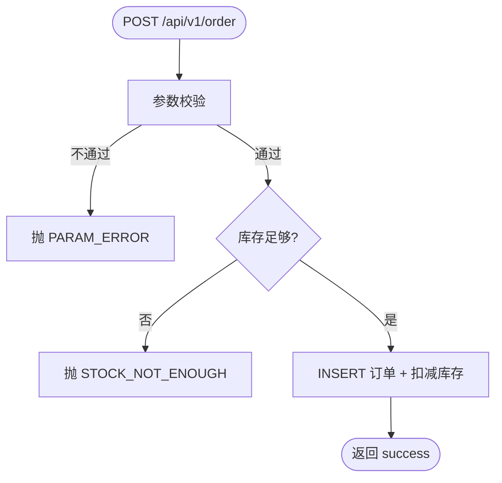
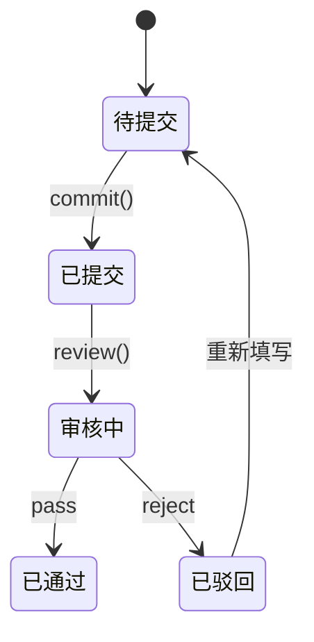

# 设计文档（10 节模板）

> 本文件被 [busi-design-doc/SKILL.md](../SKILL.md) 步骤 4 引用作为输出格式骨架。
> AI 落地 `iterate/v{版本}/{业务模块}/03-设计文档.md` 时，按本模板填充。
>
> 模块内多需求拆分 → 在本文档内采用二级章节 `## A. {需求 1}` / `## B. {需求 2}` 结构，不再拆多文件。

---

# {需求名} 设计文档

> 版本：v{版本号}  |  生成时间：{今天}  |  关联需求：§{N} of 01-需求内容.md

## 一、背景 & 范围

- 业务背景（一句话，从需求文档抽）
- 本次范围（做什么 / 不做什么，从需求文档第五章抽）
- 关联需求 / 接口（链接到 §N 和接口文档）

## 二、系统架构上下文

- 在哪些既有模块上做改动（涉及服务 / 子模块 / 包路径）
- 与现有架构的关系（是否新增层 / 是否引入新依赖）
- mermaid 模块依赖图（仅当涉及 ≥2 服务）



## 三、数据模型

> **B2 只写字段含义，B5 在这里给出完整 DDL**。

### 3.1 新建表 / 修改表清单

| 表名 | 改动 |
|---|---|
| `xxx` | 新建 |
| `yyy` | 新增 2 个字段 |

### 3.2 DDL

```sql
-- 新建表
CREATE TABLE xxx (
  id          BIGINT       NOT NULL COMMENT '主键',
  ...
  -- 审计字段：参考业务服务侧 .agent/coding-rules.md 的 BaseEntity 清单
  PRIMARY KEY (id),
  KEY idx_xxx (xxx_id, row_status)
) COMMENT='xxx';

-- 修改表
ALTER TABLE yyy ADD COLUMN ... COMMENT '...';
```

### 3.3 ER 图（如有 ≥2 张新表 + 外键关系）


## 四、关键流程

每条主流程**双轨双图必备**：时序图（谁调谁）+ 业务流程图（分支决策）。两图互补，缺一不合格。

### 4.1 {流程 1 名称} - 时序图

只画跨模块 / 跨服务的交互，单服务内的方法调用不画。



每张图配 1-2 句文字说明，不要让读者自己推。

### 4.2 {流程 1 名称} - 业务流程图（决策分支）

仅使用 mermaid 基础语法：方向 `flowchart TD`、`([])` 起止节点、`[]` 动作节点、`{}` 判断节点。**禁止 `style` 样式定义**。



流程图说明需明确列出关键决策分支（状态校验 / 数量校验 / 并发分支）与对应错误码。

### 4.3 {流程 2 名称}

依此类推，每条主流程同时给"时序图 + 业务流程图"双图。

## 五、状态机（仅当业务有状态流转）

订单 / 工单 / 审核 / 任务等有生命周期的对象**必须画**。



配状态字段映射表：

| 状态 | DB 值 | 触发事件 | 流入条件 |
|---|---|---|---|

## 六、关键决策

> 每条决策必须写：**问题 + 可选方案 + 推荐 + 权衡**。只写"做了什么"是不合格的。

### 6.1 {决策标题}

- **问题**：{为什么需要做选择}
- **可选方案**：
  - A：…（优 / 劣）
  - B：…（优 / 劣）
- **推荐 A**：理由 …
- **代价**：选 A 放弃了 …，业务规模增长到 X 时这个代价会变成 …

### 6.2 …

## 七、异常与边界

| 场景 | 处理 | 风险等级 |
|---|---|:--:|
| 空数据 | … | 低 |
| 并发提交 | 唯一索引兜底 + 业务返回友好错误 | 中 |
| Feign 超时 | 重试 N 次 + 降级返回 | 高 |
| 权限缺失 | 返回 403 + 错误码 | 中 |

**至少覆盖**：空数据、并发、超时、权限缺失、历史数据兼容、灰度 6 类（不适用就显式标"N/A，理由 …"）。

## 八、安全 & 性能

- **鉴权**：接口鉴权方式（已在 B4 接口文档定，这里复述）
- **数据隔离**：是否需按租户/门店/组织过滤
- **敏感字段**：是否需脱敏 / 加密
- **预估 QPS / 数据量**：列表接口预估行数、批量接口最大批量数
- **索引设计**：每个新查询走哪个索引，避免全表扫描

## 九、测试要点（给测试同学看）

| 用例类型 | 关键场景 |
|---|---|
| 正向流程 | 主流程完整路径 1-2 条 |
| 边界 | 空 / 单条 / 批量上限 / 跨周期 |
| 异常 | 网络中断 / 数据冲突 / 权限不足 |
| 兼容 | 历史数据 / 老版本前端调用新接口 |
| 性能 | 列表分页极限 / 批量接口上限 |

## 十、上线 / 灰度 / 回滚

- **上线步骤**：先发 DDL → 后发应用 / 先灰度 N% / 全量
- **回滚条件**：什么指标超阈值就回滚（错误率 / 延迟 / 业务侧反馈）
- **回滚动作**：是否需要回滚 DDL（一般尽量做向后兼容的 DDL，不需回滚）
