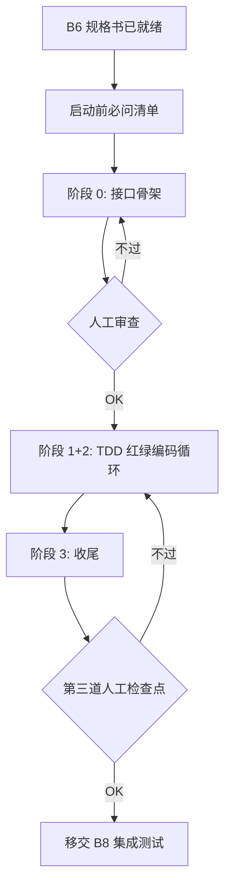

# 编码循环 Dev Loop

## 定位

**8 步流程的第 6 步，AI 实际动手干活的环节**。本 Skill 是驾驶舱，不是执行器——它负责调度协同其他 Skill 完成单功能完整循环：

| 协同 Skill | 调用时机 | 作用 |
|---|---|---|
| `busi-coding-rules` | 编码前必加载 | 阿里手册基线 + AI 通病防护 + 项目 overlay |
| `test-driven-development` | 每个功能编码前 | TDD 红绿重构骨架 |
| `systematic-debugging` | 编译/测试失败 ≥2 轮 | 强制系统排查，禁止盲改 |
| `verification-before-completion` | 提交前 | 跑通命令再宣称"完成" |
| `busi-api-test`（B8） | 全部需求单测过 | 集成测试 + Karate 回归 |

## 输入

- B6 产物：`iterate/v{版本}/{业务模块}/04-AI开发规格书.md`（文件清单 + 类签名 + 实施顺序 + TDD 用例清单）
- B4-B 产物（如双产物模式已开启）：已存在的 Controller/Form/Vo 占位代码（仅 throw UnsupportedOperationException）
- 业务服务侧 `.agent/coding-rules.md`（构建命令、Spring profile、测试框架）
- 已就绪本地开发环境（Java / 构建工具 / 数据库 / 配置中心）

## 输出

- 业务代码仓里的实际代码改动（不产文档）
- `iterate/v{版本}/{业务模块}/qa/0{n}-{需求}-qa.md` 编码期 Q&A 与未定项决议
- `iterate/v{版本}/{业务模块}/qa/00-debug-log.md` AI 死循环脱困记录（学习沉淀）
- git commit history（每功能一提交）

---

## 三阶段总流程



## 启动前必问清单（强制）

**进入阶段 0 之前，编排器必须问清以下项**（错一项不能启动）：

| # | 问题 | 用途 | 默认不提供不启动 |
|---|---|---|---|
| 1 | **开发者姓名**（格式如 `Hu.Changliang`）| Java 文件 `@author` 标签，避免填 `AI` / `system` | ✅ 必填 |
| 2 | **B4 产物模式**（双产物 / 单产物）| 决定阶段 0 是否跳过 Controller/Form/Vo 生成 | 默认双产物（从 B4 状态读）|
| 3 | **commit message 语言**（中文 / 英文）| 业务代码仓 git commit 语言，与项目现有风格一致 | 默认从 `.agent/coding-rules.md` 读，未设则问 |

**存储**：将答案写入 `.flow-state.json` 的 `dev_context` 字段，同一版本内后续模块复用（作者可额外确认）。

## 阶段 0：接口骨架

**目标**：让人类**先看到接口契约长什么样**，再决定填不填实现。

### 产出范围

**依赖 B4 产物模式**：

| B4 模式 | 阶段 0 产出 |
|---|---|
| **双产物**（Controller/Form/Vo 已存在）| 仅补 Service 接口 + 空实现、Mapper、Entity 骨架。Controller 保留 `throw UnsupportedOperationException` 不动 |
| **单产物**（仅 markdown）| 按 B6 §二文件清单全量生成，Controller/Form/Vo 也在本阶段产出 |

通用范围：

1. Controller / Feign 接口的方法签名（注解 + 入参 + 返回类型）——双产物下 B4 已产出，仅复查
2. 方法体只返回占位（`null` / `Result.success(null)` / 空集合 / `throw UnsupportedOperationException`）
3. 新增 Form / Vo / Entity 字段（按 B4 接口文档 + B5 数据模型）
4. 新增空 Service 接口（方法签名）+ 空实现类（throw `UnsupportedOperationException`）
5. **新增 Java 文件必须贴 `@author {启动前问到的开发者姓名}`**

### 不产出

- Service / Mapper 实现逻辑
- SQL（DDL 见 B5，由 DBA / 开发手动执行或迁移脚本）
- 单元测试（阶段 1 才写）

### 执行

1. 按 B6 §五拓扑序生成骨架（Entity → Mapper → Service → Controller → Feign）
2. 每加完一层立即执行编译命令（命令从 `.agent/coding-rules.md` 取，**不要写死 `mvn compile`**——可能是 gradle / sbt）
3. 编译失败 ≥2 轮 → 触发**死循环脱困机制**（见下文）
4. 全模块骨架编译通过后输出审查摘要：
   - 新增/修改接口清单（路径 + 方法名）
   - 新增/修改字段清单（类 + 字段 + 类型）
   - 总改动文件数

### 出口卡口

**主动告知**：

```
阶段 0 接口骨架已就绪：
- 共 N 个文件，K 个新增接口，M 个新增字段
- 编译已通过：✅ {命令输出}

请审查接口契约是否符合预期。OK 后说"骨架审过"进入阶段 1+2。
```

**不自动跳**。

---

## 阶段 1+2：TDD 红绿编码循环

> 编码与单元测试**强绑定**——单功能 5 步循环，禁止攒到末尾批量提测。

### 单功能 5 步循环

按 B6 §六 TDD 清单逐个用例驱动：

```
1. 红 — 写一个失败的测试（基于 B6 §六）
2. 绿 — 写最小实现让测试通过
3. 重构 — 在测试保护下清理代码
4. 编译 + 跑全模块测试 — 不只是当前测试
5. 提交 — git commit（用户确认后）
```

### 每步硬约束

| 步骤 | 约束 |
|---|---|
| 1. 红 | 测试必须真的失败一次（看到红）才能进 2，禁止"先写实现再补测试" |
| 2. 绿 | 只写让当前测试通过的最小代码，禁止顺手写下一个用例的实现 |
| 3. 重构 | 重构后测试必须仍全绿，否则回滚 |
| 4. 编译 + 全测 | 不只跑当前测试——必须全模块测试通过，避免改 A 坏 B |
| 5. 提交 | 必须用户确认（详见提交规约） |

### 何时调度 systematic-debugging

满足任一条件**强制**调用 `systematic-debugging`，禁止继续盲改：

- 编译失败 ≥2 轮
- 同一测试失败 ≥2 轮
- 修了 A 测试通过但 B 测试又挂（修了 A 坏 B）
- 同一文件同一片段被反复改 ≥3 次

### 调度 verification-before-completion

每次准备说"测试通过 / 已修复 / 已完成"前**强制**调用，按它的规范做：先跑命令、看输出、再宣称。**禁止凭记忆/推测断言完成**。

---

## AI 死循环脱困机制

> 这是本 Skill 最重要的安全网。AI 在编码循环里典型死循环：编译过测试不过、修 A 坏 B、同一片段反复改、报"已修复"实际没修。

### 触发条件（任一即触发）

1. 编译失败 ≥3 轮
2. 同一测试失败 ≥3 轮
3. 同一文件同一方法被改 ≥3 次仍报错
4. 出现"修 A 坏 B 又修 B 坏 A"反复
5. 用户出现挫败信号（"又错了"/"为什么还不行"）

### 脱困动作（强制按序，禁止跳步）

```
Step 1: 停手 — 立即停止任何代码改动，不再 fix
Step 2: 看 diff — git diff HEAD~3 HEAD --stat 看最近改了什么
Step 3: 读错误原文 — 不读总结、不复述，贴完整堆栈第一行
Step 4: 写假设 — 在 develop/qa/00-debug-log.md 写：
        - 当前症状（一句话）
        - 已尝试方案（每条 1 行）
        - 当前根因假设（X 是因为 Y）
        - 验证假设需要的信息
Step 5: 拉人介入 — 把 Step 2-4 内容贴给用户，主动求助
```

**绝对禁止**：

- ❌ "让我再试一种思路…" → 没复盘 diff 直接试
- ❌ "我猜可能是…" → 不读错误原文凭直觉
- ❌ "已修复 ✅" → 没跑命令验证
- ❌ 偷偷绕过测试（`@Ignore` / `@Disabled` / 删测试）

---

## 提交规约

### 颗粒度

- 单功能、单提交、不混功能（一个 commit 对应 B6 §六的一条 TDD 用例 → 实现）
- 单提交建议 < 200 行（通用基线，业务服务侧可调整 overlay）
- 历史改动相关的修复合到同一 commit，不要拆碎成"修了又修"

### commit message

根据启动前问到的 commit 语言选中文或英文模板：

中文模板：

```
功能({模块}): {需求 §N} - {一句话动作}
测试({模块}): 补 {场景} 测试
修复({模块}): {根因}导致{症状}
重构({模块}): {目的}
```

英文模板：

```
feat({module}): {需求 §N} - {一句话动作}
test({module}): 补 {场景} 测试
fix({module}): {根因}导致{症状}
refactor({module}): {目的}
```

模块名从 `.agent/coding-rules.md` 模块清单取（不要凭印象写）。

### 提交前自检（每次必跑）

- ✅ 编译通过
- ✅ 全模块测试通过（不只是新加的）
- ✅ 无硬编码密钥 / 测试用 token
- ✅ 无 PII（如真实手机号、身份证）
- ✅ 响应字段与 B4 接口文档一致
- ✅ 新增字段在注释或 javadoc 标注 `// added in v{版本}`

### 不自动提交

每次提交前必须**主动告知**：

```
准备提交：
- 文件：N 个
- 信息：feat(...): ...
- diff 摘要：+X / -Y 行
- 自检 6 条：全过

确认提交吗？
```

用户回 "提交" / "yes" 才执行 `git commit`。**不自动 push**——由 B9 收尾时统一推送。

---

## 阶段 3：收尾移交 B8

阶段 1+2 全部需求的 TDD 用例都过后：

1. 跑一次全模块完整测试，截图/输出贴给用户
2. 列出本轮所有 commit 的清单（`git log --oneline`）
3. **第三道人工审查检查点**：

```
编码 + 单测已完成（第三道人工审查检查点）：
- N 个需求 / K 个 commit / M 个测试全绿
- 测试覆盖 B5 §七 异常 6 类：✅ / ⚠️ N/A 项见 ...
- 待澄清遗留：见 develop/qa/

请审核代码与单测后说"OK"，进入 B8（busi-api-test）做集成回归。
```

不自动跳 B8。

## AI 反模式

1. **跳过阶段 0** —— 直接写实现，没让人审接口契约 → 后期改动放大
2. **跳过 TDD 红** —— 先写实现再补测试 → 测试只验证当前实现，发现不了真 bug
3. **盲改** —— 编译失败/测试失败不调 `systematic-debugging`，凭直觉改第 4 次 → 必死循环
4. **绕过测试** —— `@Ignore` / `@Disabled` / 删除测试以"通过"
5. **凭记忆宣称完成** —— 没跑命令就说"已修复" → 违反 `verification-before-completion`
6. **混功能提交** —— 一个 commit 跨 3 个需求 → diff 评审困难
7. **方法体写在阶段 0** —— 阶段 0 应只产签名，写实现违反两阶段精神
8. **改 A 坏 B 不停** —— 不复盘 diff，反复试 → 必触发脱困机制
9. **不自检就提交** —— 跳过 6 条自检（密钥 / PII / 字段一致 / 测试通过…）
10. **自动 push** —— B7 只 commit 不 push，统一由 B9 处理

## 业务服务侧 overlay 必填

| 内容 | 用途 |
|---|---|
| 编译命令 | `mvn compile` / `gradle compileJava` / `mvn -pl {module} compile -am` |
| 全模块测试命令 | `mvn test` / `gradle test` / 带 profile 的具体命令 |
| 集成测试启动方式 | Spring profile 名（如 `dev` / `test`）+ 端口 + 外部依赖（DB / Nacos / Redis） |
| Spring 服务启动方式 | `mvn spring-boot:run -Dspring-boot.run.profiles=...` 或 IDE 配置 |
| 单测目录 | `src/test/java` 还是别的位置 |
| 提交粒度上限 | 默认 200 行，项目可调（小项目 100 / 大项目 500） |
| **commit message 语言** | `中文` / `英文`（未设则启动前问） |
| **作者姓名格式** | `Hu.Changliang` 还是项目自定义 |
| **`@author` 默认填法** | 启动前询问 还是从 git config user.name 读 |
| commit message 模块名清单 | 项目实际模块名映射（如 `omp` / `analysis` / `train`） |
