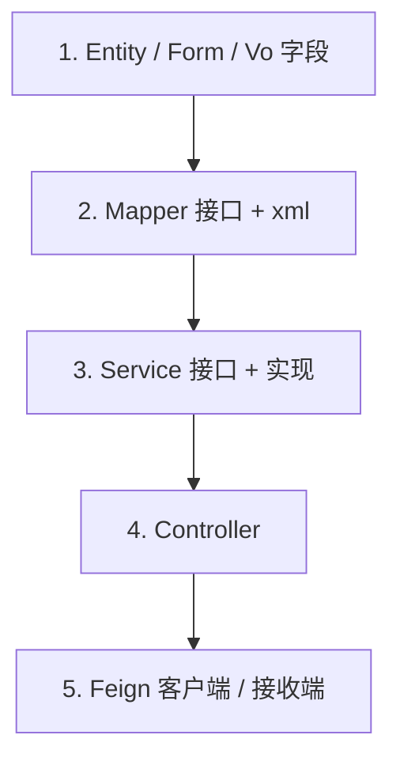

# AI 开发规格书（7 节模板）

> 本文件被 [busi-dev-spec/SKILL.md](../SKILL.md) 步骤 3 引用作为输出格式骨架。
> AI 落地 `iterate/v{版本}/{业务模块}/04-AI开发规格书.md` 时，按本模板填充。
> 不要重抄 B5 已有内容（DDL / 决策权衡 / 流程图等），用引用 `[03-设计文档.md §x](./03-设计文档.md)` 形式回链。

---

# {需求名} AI 开发规格书

> 关联文档：
> - 需求：[01-需求内容.md §N](./01-需求内容.md)
> - 接口：[02-接口文档-内部.md](./02-接口文档-内部.md) / [02-接口文档-外部.md](./02-接口文档-外部.md)
> - 设计：[03-设计文档.md](./03-设计文档.md)

## 一、概要

- 一句话目标
- 影响服务/模块清单：`order-svc / inventory-svc`
- 是否涉及表结构变更（是 → 引用 B5 §3.2 DDL，否 → 标"无"）

## 二、文件清单

> 路径必须从仓库根开始的**绝对相对路径**，AI 直接拷贝即可定位。

### 新增

| 文件 | 类型 | 用途 |
|---|---|---|
| `order-svc/src/main/java/.../service/XxxService.java` | 接口 | 业务接口 |
| `order-svc/src/main/java/.../service/impl/XxxServiceImpl.java` | 类 | 业务实现 |
| `order-svc/src/main/resources/mapper/XxxMapper.xml` | XML | MyBatis 映射 |
| `order-svc-feign/.../api/InnerXxxApi.java` | 接口 | Feign 客户端 |

### 修改

| 文件 | 改动摘要 |
|---|---|
| `order-svc/.../controller/OrderController.java` | 新增 `@PostMapping("/x")` 方法 |
| `order-svc/.../entity/OrderEntity.java` | 新增 `isRead` 字段 |

### 删除

| 文件 | 原因 |
|---|---|

## 三、类与方法装配

每个改动的类列出**完整签名**（精确到参数类型 + 返回类型 + 注解）。AI 拿着这个写 import 即可。

### 3.1 `XxxServiceImpl`（新增）

包：`com.xxx.order.service.impl`

依赖（注入）：
- `XxxMapper xxxMapper`
- `InventoryFeignApi inventoryFeignApi`
- `IdGenerator idGenerator`（如需）

方法清单：

| 方法签名 | 类型 | 说明 |
|---|---|---|
| `Long create(XxxForm form)` | 新增 | 创建主流程，对应接口 §1 |
| `XxxVo findById(Long id)` | 新增 | 详情查询，对应接口 §2 |
| `void updateRead(Long id, Long employeeId)` | 新增 | 标记已读，对应接口 §3 |

### 3.2 `OrderController`（修改）

新增方法：

```text
@PostMapping("/x/v1/markAsRead")
@SaCheckLogin   // 鉴权注解从 .agent/coding-rules.md 取
public Result<Boolean> markAsRead(@RequestParam Long id)
```

调用链：`Controller → XxxService#updateRead(id, currentEmployeeId)`

> **不写方法体**。方法体是 B7 的事，本文档只产签名。

### 3.3 `XxxMapper`（新增）

| 方法 | SQL 类型 | xml 节点 |
|---|---|---|
| `int insertOnce(XxxEntity)` | INSERT IGNORE | `<insert id="insertOnce">` |
| `List<XxxEntity> findByIds(List<Long>)` | SELECT IN | `<select id="findByIds">` |

> SQL 详细语句**引用 B5 §3.2 DDL/查询章节**，不在本文档重抄。

## 四、SQL 变更

> 完整 DDL 见 [03-设计文档.md §3.2](./03-设计文档.md#32-ddl)。

执行顺序：

1. 先建表 / 加字段（向后兼容）
2. 数据初始化（如有）
3. 后发应用代码

## 五、实施顺序（编译可过的拓扑序）



**强约束**：
1. 严格按拓扑序写，每完成一层 `mvn -pl {module} compile` 必须通过
2. 不允许出现"先写 Controller 调用一个还不存在的 Service 方法"
3. 接口骨架阶段（B7 第一步）只把方法签名 + 空实现写出来，整体先 `mvn compile` 通过

## 六、TDD 测试用例清单

> **B7 编码前必须先写测试**（红 → 绿 → 重构）。本节列出本次必备的测试用例，B7 按此清单先创建测试文件。

| # | 测试类 | 测试方法 | 场景 | 类型 |
|---|---|---|---|:--:|
| 1 | `XxxServiceImplTest` | `create_normal_returnsId` | 正向流程 | unit |
| 2 | `XxxServiceImplTest` | `create_duplicateKey_throwsBusinessException` | 唯一索引冲突 | unit |
| 3 | `XxxServiceImplTest` | `findById_notExist_returnsNull` | 不存在 | unit |
| 4 | `OrderControllerKarateTest` | `feature: markAsRead` | 端到端 | karate/integration |
| 5 | `XxxServiceImplTest` | `updateRead_concurrent_idempotent` | 并发幂等 | unit |

**覆盖检查**（参照 B5 §七 异常 6 类）：
- 空数据 / 单条 / 批量上限
- 并发 / 幂等
- 鉴权失败
- Feign 超时 / 降级
- 历史数据兼容

## 七、AI 编码防呆清单（仅本需求特有）

> 通用编码约束已在 `busi-coding-rules` Skill 强制加载。本节只列**本需求特有**的易错点。

- ⚠️ {需求特有的踩坑点 1，如"X 字段在历史数据中可能为 null，新代码必须容忍"}
- ⚠️ {需求特有的踩坑点 2，如"批量 Y 接口在生产数据量上限是 1w，超过必须分片"}
- ⚠️ {需求特有的踩坑点 3，如"Z 表的 row_status 0/1 与本项目其他表语义相反，注意"}

如果一项都列不出来，说明本需求没有特殊风险，直接写"无"即可。**不要为了凑数编**。

---

## 索引文件模板（00-AI开发规格书.md）

> 多需求模块时，单个版本下用一份索引串起来。

```markdown
# v{版本} AI 开发规格书

## 模块索引

| 序号 | 需求 | 文件 |
|------|------|------|
| 1 | xxx | 01-xxx.md |

## 全局实施顺序

跨需求的依赖（如需求 2 依赖需求 1 的新表）：

​```mermaid
graph TB
  R1[需求 1: 新建 xxx 表] --> R2[需求 2: 复用 xxx 表写消费]
​```

## 全局约束

- 编码基线：`busi-coding-rules`
- 项目特化：`.agent/coding-rules.md`
- 待澄清留存：…（如有 ⚠️ 未明确项，开发期遇到再决）
```
